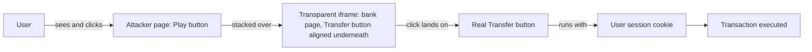
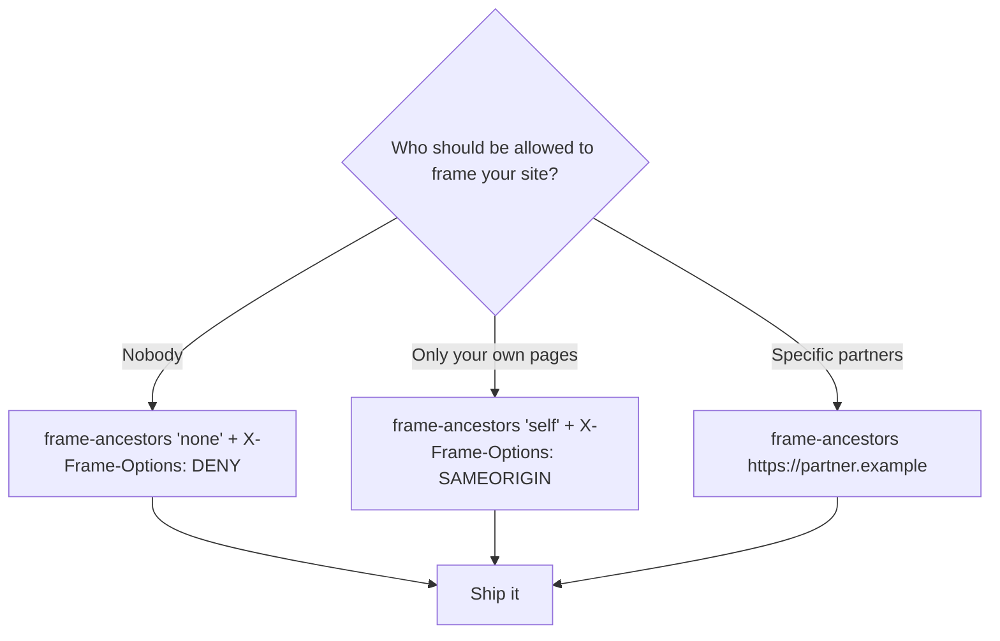

Clickjacking is a UI redressing attack. The attacker loads your page in a transparent iframe, stacks their own content on top, and lines the layers up so a click the user thinks is harmless lands on a real button on your page. That click carries the user's session. From your server's side, it looks exactly like the user meant it.

## The Attack, Step by Step

The user visits the attacker's page, sees something ordinary (a quiz, a video, a "claim your prize" button), and clicks. The click passes through the invisible layer and lands on your transfer button, your delete button, or a grant-permissions dialog instead.



## Why It Works

Browsers render any page in an iframe by default. Framing a page is not blocked by the same-origin policy; only scripting across the frame boundary is. The click arrives with the user's cookies attached, so your server can't tell it came from a framed page rather than the page you shipped. Nothing leaves the browser and nothing is "hacked". The user did everything themselves, one layer at a time, which is what makes it hard to spot in logs.

## Catching It in the Browser

Framing is detectable client-side. `window.self !== window.top` is true whenever a page is framed, and both properties stay readable even cross-origin, so it works no matter who did the framing.

I keep a small guard script for exactly this in my PoC repo:

```html
<script>
  window.ClickjackGuardConfig = {
    bustOut: true, // try to break out of the frame
    showWarning: true, // full-screen warning overlay when framed
    onCheck: function (isFramed) {
      if (isFramed) alert('Clickjacking detected: this page is being framed!');
    },
  };
</script>
<script src="/clickjacking-guard.js" defer></script>
```

| Option        | Default         | Meaning                                       |
| ------------- | --------------- | --------------------------------------------- |
| `bustOut`     | `true`          | Navigate the top window to this page.         |
| `showWarning` | `true`          | Render a warning overlay when framed.         |
| `warning`     | *(default text)* | Overlay text.                                  |
| `onCheck`     | `null`          | Called with `true`/`false` after the check.    |

If you load the guard from a CDN, pin it to a commit. And don't use the raw GitHub URLs: `github.com/.../blob/...` serves HTML and `raw.githubusercontent.com` serves plain text, so the browser refuses to execute either as a script. `cdn.jsdelivr.net/gh/...` serves JavaScript with the right MIME type.

| URL                                                                                   | Served as          | Result                     |
| ------------------------------------------------------------------------------------- | ------------------ | -------------------------- |
| `github.com/mrSamDev/security-pocs/blob/main/clickjacking/clickjacking-guard.js`      | `text/html`        | HTML page, not JS          |
| `raw.githubusercontent.com/mrSamDev/security-pocs/main/clickjacking/clickjacking-guard.js` | `text/plain` | "MIME type not executable" |
| `cdn.jsdelivr.net/gh/mrSamDev/security-pocs@<commit>/clickjacking/clickjacking-guard.js` | `application/javascript` | Works |

## The Real Fix Is a Response Header

Client-side detection is best-effort. An attacker who controls the framing page can strip your script by intercepting it, or neutralize it with `<iframe sandbox>` and no `allow-scripts`, and then the guard never runs. The robust fix never reaches the attacker's hands: the browser refuses to render your page in a frame at all.

```
Content-Security-Policy: frame-ancestors 'none'
X-Frame-Options: DENY
```

CSP `frame-ancestors` is the modern directive. `X-Frame-Options` covers older browsers. Send both. They cost nothing.



Setting this in a Vercel deploy looks like:

```json
{
  "headers": [
    {
      "source": "/(.*)",
      "headers": [
        { "key": "X-Frame-Options", "value": "DENY" },
        { "key": "Content-Security-Policy", "value": "frame-ancestors 'none'" }
      ]
    }
  ]
}
```

## Test It Yourself

Don't trust the header. Check it.

- **Stand-alone checker** (no external JS, works from a plain static host): [cj-deploy.vercel.app/clickjacking/clickjacking-test.html](https://cj-deploy.vercel.app/clickjacking/clickjacking-test.html). Append `?url=https://your-site.example` to test a target directly.
- **Demo lab**: [cj-lab-sand.vercel.app](https://cj-lab-sand.vercel.app) embeds two pages side by side. One is intentionally framable; one sends `X-Frame-Options: DENY` and `CSP: frame-ancestors 'none'` and stays blank in a frame. The difference is the whole lesson.
- **Locally**: frame targets need http(s), `file://` won't do.

```bash
python3 -m http.server 8080
```

## Reference

**Reference:** [security-pocs on GitHub](https://github.com/mrSamDev/security-pocs/tree/main/clickjacking) · [OWASP Clickjacking Defense Cheat Sheet](https://cheatsheetseries.owasp.org/cheatsheets/Clickjacking_Defense_Cheat_Sheet.html) · [MDN: X-Frame-Options](https://developer.mozilla.org/en-US/docs/Web/HTTP/Reference/Headers/X-Frame-Options)
