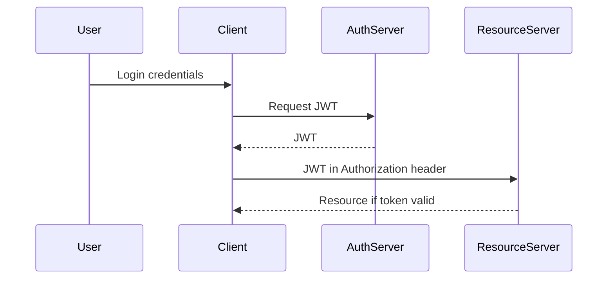
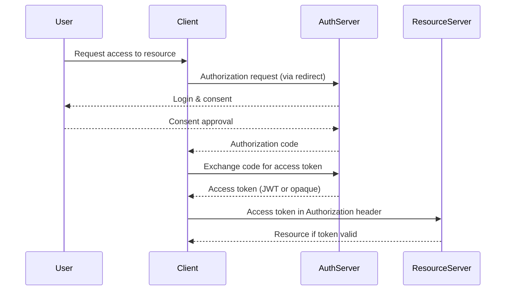

A JSON Web Token, or JWT, is a compact, URL-safe way to pass claims between two parties. It lets a server avoid storing session state, which suits web apps and APIs. A JWT has three parts, header, payload and signature, each base64url encoded and joined by dots. The payload is not encrypted, so don't put secrets in it.

The header says how the token was made. It usually carries `typ: JWT` and `alg` for the signing algorithm. HS256 uses a shared secret for HMAC with SHA-256. RS256 and ES256 use asymmetric keys, where the issuer signs with a private key and anyone can verify with the public key. That scales well across services. Keep your key management tight.

The payload carries claims about the subject and the token. Registered claims include `sub` for subject, `iat` for issued at, `exp` for expiration, and `aud` for audience. You can add public or private claims, but anyone can decode them, so keep sensitive data out. The signature protects integrity and authenticity. The server recomputes it and rejects the token if anything changed.

You can watch all three parts decode by hand in the [JWT debugger](/tools/jwt-decoder/). It runs in the browser, signature verification included, with the secret or the public key.

A common JWT lifecycle starts after login. The auth server issues a token with the claims it needs and an expiration. Clients store it in memory, in cookies, or in localStorage, each with its own trade-offs. Cookies attach to requests automatically, which is convenient but leaves you open to CSRF unless you set `SameSite` and add anti-CSRF measures. Sending the token in the Authorization header avoids CSRF, at the cost of more work on the client.

On the server, verify the signature with the secret or public key. Then check claims like `exp` and `nbf` before you trust the request. Small clock skews happen, so allow a little leeway. Once `exp` passes, the token is dead and the user has to reauthenticate or use a refresh token. OAuth 2.0 defines refresh tokens and a way to mint new access tokens without pestering the user.

JWTs scale because the server tracks no state. Instant logout is the price: without a revocation list or short-lived tokens, a stolen token stays valid until it expires. Keep claims lean, or every request pays a bandwidth tax. Pick sound algorithms, protect your keys, keep secrets out of the payload, and validate every token. Use Bearer headers for APIs and handle cookies with care.

JWT security comes down to a few rules. A stolen token works until it expires, so keep lifetimes short or keep a revocation list. A captured token can be replayed, so add a nonce or a jti check when it matters. Never accept `alg: none` or a weak algorithm, and always enforce your chosen algorithm and key length. And never put passwords or secrets in the payload, because anyone can read it. That `alg: none` case deserves its own write-up, and I have one in [JWT alg:none](/guides/jwt-alg-none/).

People confuse JWTs with OAuth all the time. They are not the same thing. OAuth 2.0 is an authorization framework, which defines how clients get access tokens through consent and server checks. A JWT is a token format, sometimes used to carry the claims. OpenID Connect builds on OAuth and standardizes ID tokens as JWTs, which is why you see them everywhere in modern login flows.

Take Google Sign In. OAuth handles the redirects, the consent screen, and the token exchange. The ID token it returns is a JWT. You verify its signature and claims like `iss`, `sub`, `aud`, and `exp`. That tells you the token came from the right issuer, targets the right audience, and hasn't expired. The two solve different parts of the problem, and they work well together.

OAuth flows have their own failure modes. Public clients should always use PKCE to stop authorization codes from being stolen. Validate redirect URIs strictly, or you invite malicious redirects. Access and refresh tokens leak through URLs, localStorage, and logs, so store them securely and run everything over HTTPS. Any flow with a redirect has to guard against CSRF and clickjacking, especially in a browser.

### JWT Flow

### OAuth 2.0 Flow

| Feature        | JWT                                                                                    | OAuth 2.0                                                                                                |
| -------------- | -------------------------------------------------------------------------------------- | -------------------------------------------------------------------------------------------------------- |
| Type           | Token format                                                                           | Authorization framework                                                                                  |
| Purpose        | Pass claims between parties, stateless authentication                                  | Manage delegated access and token issuance                                                               |
| Structure      | Header.Payload.Signature (base64url)                                                   | Access tokens (JWT or opaque) plus refresh tokens                                                        |
| Server Storage | Not required                                                                           | Tokens may be stored or managed by the server                                                            |
| Claims         | sub, iat, exp, aud plus custom                                                         | Standardized scopes and permissions, optional ID token claims                                            |
| Security       | Signature ensures integrity, payload not encrypted, beware of theft and replay attacks | Token issuance via secure flows, supports JWTs for ID tokens, watch for code interception, token leakage |
| Flow           | Simple login → token → API                                                             | Redirect → consent → code → token → API                                                                  |
| Use Case       | Stateless APIs, microservices, SPA auth                                                | Third party app access, delegated permissions, login flows                                               |
| Pros           | Lightweight, scalable, self-contained                                                  | Flexible, standardized, supports refresh tokens                                                          |
| Cons           | Instant logout is hard, risk of exposing sensitive data                                | More complex, requires server coordination and redirects                                                 |
